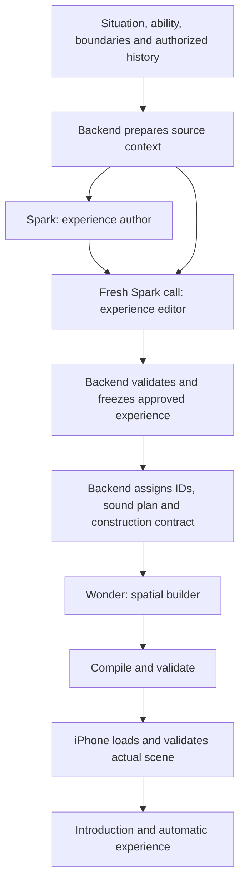

# Scene-generation chain revision plan — November 3, 2026

Proposal for the current native Braive product. The recommended default is **experience author → independent experience editor → spatial builder → deterministic compilation → native validation**. Use three generation calls: Spark, a fresh Spark call, then Wonder. The editor replaces the current standalone audio-selection call once local audio-plan assembly is implemented.

This design separates authoring from evaluation. It does not assume that fewer calls mean less reasoning work. The editor adds review work before construction; improved first-pass quality and fewer downstream repairs are hypotheses to measure.

The product remains an automatically unfolding situation. Looking around and relevant speech are participant capabilities. The generated world does not branch in response to participant behavior, require spoken navigation, or wait for participant actions to advance. Character conversation can respond within that situation without directing its world progression.

## 1. What the current chain actually does

The normal path in `backend/src/server.ts` is sequential:

1. Spark produces a full SessionPlan: interpretation, personalization, intensity, duration, cast/assets, props, stage goals, introduction, sound brief, construction intent, safety and tool scheduling.
2. Spark produces an AudioPlan from that plan and six bundled audio assets.
3. Wonder produces a SceneSpec, including geometry, layout, movement paths, executable stages, environment, construction relationships and review metadata.
4. Backend code canonicalizes references, compiles spatial relationships and validates the assembled result.
5. The iPhone loads real geometry and performs native validation. Backend and native repair share one repair allowance and the attempt deadline.

The audio call blocks scene construction because the builder receives its cue IDs. Both the coordinator and builder receive the entire shared authoring document and full capability payload. That document mixes experience direction, specialist geometry instructions, scheduling boilerplate and validation details.

Offline measurements from this checkout, using UTF-8 bytes rather than token estimates:

| Item | Bytes |
| --- | ---: |
| Shared authoring instructions | 19,215 |
| Compact inventory of 355 assets | 18,383 |
| Bounds dictionary for all 355 assets | 46,987 |
| Provider SessionPlan schema | 9,175 |
| Provider SceneSpec schema | 18,369 |
| Provider AudioPlan schema | 1,630 |

Instructions, inventory, bounds and response schema alone therefore contribute approximately 94 KB to the coordinator request and 103 KB to the builder request, before other instructions, user input, history, the approved plan and prior output. These measurements establish repeated payload, not its share of observed latency.

The retained rejected scene also contains an environmental node with `geometry.kind=asset` and an empty asset ID. The geometry schema permits that empty string; construction rejects it later. An experience editor would not solve this technical failure. Schema constraints and compilation must handle it.

## 2. Recommended chain

The normal path has three model calls, as the current path does. The second call now performs editorial review. A local compiler turns structured sound selections into the existing AudioPlan. A shared bounded repair remains available for invalid output or native failure; it is outside the normal three-call path.

Keep the existing Spark 1.3 and Wonder 1.0 assignments initially. A fresh editor call can use the same model family as the author while having separate instructions and context. That supplies a distinct task and a fresh evaluation, though their errors may remain correlated. A Wonder editor is an experiment to compare if Spark repeatedly misses important issues; it would add another Wonder call to each normal generation.

Meta describes Spark as suitable for latency-sensitive work and Wonder as suitable for more demanding work. That supports the starting assignment, but does not establish performance on Braive's tasks. [Official model guidance](https://dev.meta.ai/docs/models)

## 3. Responsibilities and authority

| Owner | Decisions it owns | Material it needs |
| --- | --- | --- |
| Experience author | Interpret the request and current ability; propose difficulty, duration, cast, setting, automatic progression, sensory content and sound selections | Original input, authorized history, current corrections, concise capability summary |
| Experience editor | Independently check fidelity, boundaries, coherence, pacing and practical feasibility; accept or revise the proposed experience | Original source context, proposed experience, concise capability summary |
| Backend | Source authority, consent, IDs, revisions, deadlines, repair accounting, tool scheduling, defaults, audio assembly and immutable approved contract | Validated source context and edited experience |
| Spatial builder | Realize the approved experience through assets, architecture, spatial relationships, movement paths and supported operations | Approved contract, exact relevant capabilities/assets and builder schema |
| Compiler and validators | Resolve relationships; check references, geometry, resources, timing and required coverage | Full assembled artifacts and authoritative inventory |
| Native app | Actual loaded-geometry checks, synthesized speech duration, rendering, playback, pause and STOP behavior | Existing plan/scene/audio result |

The author and editor are the two parts of the coordinating phase. Both return the same ExperienceDraft schema. The editor always returns a complete final experience, unchanged when the draft is already good and revised when corrections are useful. The backend validates that output and freezes it as the builder's approved contract. The builder cannot change the approved situation, intensity, duration, explicit cast or boundaries to make construction easier.

User-specified facts and boundaries remain authoritative throughout. Before approval, the editor may revise the author's proposed details, such as pacing or an unspecified duration. It cannot rewrite the source request. A substantive unsupported requirement is reported through the experience's existing safety/capability fields.

## 4. The experience author

Replace the provider-facing full SessionPlan with a smaller internal ExperienceDraft. The current public SessionPlan remains the assembled wire format.

The draft should contain:

- Topic, setting and central experience, with explicit user requirements distinguished from proposed details.
- Current ability, relevant preferences, difficulty, duration and rationale.
- Cast roles and any user-specified count or appearance requirements.
- Functional props and essential spatial needs, expressed semantically.
- Ordered stages: what the participant sees, hears and experiences; proposed time allocation; automatic completion intent; movement intent; quiet or spoken content.
- Relevant conversation availability and the people who can converse. Speaking does not become a progression requirement.
- A concise introduction and any essential authored character/narrator lines. Native speech measurement remains authoritative.
- Structured selections from the actual audio palette, plus any essential sound that is unavailable.
- Safety/capability decision and explicit requirements that later construction must preserve.

Remove technical node IDs, copied session/revision fields, raw mesh bounds, full asset inventories, transform math, repeated tool arguments and fixed feedback scheduling from this model's obligations. Backend code supplies those mechanics.

The author still performs real creative and personalization work. Its reduced technical context makes that work more focused; adding an editor does not halve the author's workload.

## 5. The independent editor

The editor's sole purpose is to improve the proposed experience. Give it original source material directly so it can detect errors in the author's interpretation. Do not supply an author's self-assessment as authority.

Its review should answer:

1. Does this actually deliver the requested situation, including required movement where relevant?
2. Does it respect the person's current ability, explicit boundaries and authorized history?
3. Is the sequence understandable as an experience that happens to the participant?
4. Is there enough time to settle, experience its central content and reach a coherent ending?
5. Can the participant look around freely without being expected to steer or trigger the world?
6. Is relevant conversation available naturally, with no requirement to speak for progression?
7. Are quiet moments intentional, and is narration limited to useful context or natural speech?
8. Are the proposed effects supported by actual capabilities? Visual water cannot stand for simulated buoyancy, for example.
9. Are important perceptual details and functional props specified clearly enough for construction?
10. Has the author added unnecessary threats, participants, tasks or complexity?

The editor returns a complete ExperienceDraft in every case. Preserve the original content when it is already good; directly revise material issues when necessary. Do not manufacture changes, return a review essay, request another author pass, or wrap the output in a separate accept/revise decision envelope.

The handoff is simply: validate the editor's returned plan against the schema, source constraints and safety/capability fields; then start the spatial builder with that plan. An invalid or unsupported result follows the existing bounded repair or explicit recovery path. No extra review model or user approval step is introduced.

Use one shared schema for author and editor output. Keep edit comparisons in optional backend diagnostics computed from the two artifacts; the editor does not need to generate a change log. Avoid a generic JSON patch interpreter or another author/editor conversation loop.

This simplifies orchestration and avoids extra revision round trips. Returning an unchanged plan still requires generating its full output, so it is not inherently faster than returning a tiny acceptance flag. Keep the experience representation concise and measure end-to-end time.

Editing is a normal planned stage. Rerunning an editor because it produced invalid output would consume the existing shared repair allowance. Normal editorial revision does not itself count as an error repair.

The editor evaluates the intended experience. It cannot certify loaded geometry, occlusion, optical comfort, animation quality, or actual speech duration. Those remain construction and native responsibilities.

## 6. Local assembly and audio

After validating the editor's final plan, backend code should:

1. Assign stable IDs to stages, cast, props and sound cues.
2. Bind approved character appearances and registered voice defaults.
3. Produce the existing SessionPlan, including typed tool declarations and their enforced execution phases.
4. Assemble AudioPlan from the approved structured sound selections and app-owned mixing defaults.
5. Derive the builder's requirement bindings and exact asset/capability package.

Keep semantic sound choice in the coordinating phase: the author already decides the sound brief, and the editor reviews it. Replace its freeform-only representation with a small structured selection from the six actual bundled assets. Code supplies layer IDs, loop defaults, gain mappings, ducking and the transition whoosh. This removes the standalone audio model call without asking another model to write the full AudioPlan.

The initial adapter should emit timing supported by the current player. Ensure each sound has one playback trigger: scheduled layer playback or an operation, never both accidentally. Stage-relative scheduling requires explicit runtime support where absolute active-time scheduling cannot represent the intended behavior. Do not add unsupported timing fields to generated output.

An essential unavailable sound is a capability gap, not permission to relabel an unrelated bundled recording. If a future sound inventory needs a dedicated audio specialist, it can run alongside spatial construction after stable cue IDs and approved timing semantics have been assigned.

## 7. Spatial construction and prompt reduction

For the first implementation, keep Wonder's existing SceneSpec output and current spatial compiler. Introduce the author/editor internal contracts behind the existing job API. This allows native parity checks without simultaneously replacing the scene representation.

Give Wonder builder-specific instructions. Keep experience-author and editor instructions out of its prompt. Pass the frozen experience, exact bindings, approved sound cues and only the source details needed to preserve requirements.

Initially, the full asset catalog and bounds can remain in the builder request while being removed from both planning calls. A subsequent catalog selector can supply relevant categories and measured bounds based on the approved setting and functional needs. Selection must preserve required objects and permit procedural assemblies; the full inventory stays available. This is component selection, not selection of preset practice scenes.

Strengthen provider schemas: asset references must be nonempty and registered; primitive variants must contain their own dimensions; unsupported fields should be absent. Continue semantic validation after structured output.

The 355 current asset IDs total 14,568 characters. Meta's documented cap for a single string enum over 250 values is 15,000 combined characters, so an enum containing the entire catalog has little growth margin. Check schema limits automatically when constructing enums or candidate subsets. [Official structured-output constraints](https://dev.meta.ai/docs/structured-output)

A more compact SceneBlueprint is a later implementation option within this architecture. It can reduce duplicate transforms, requirement mappings and metadata by having the compiler generate more of SceneSpec. That is a larger compiler change and should be assessed separately from the author/editor experiment.

## 8. Revisions, failure and readiness

- A completed builder addition creates a new revision and visible preparation attempt. The author receives the previous experience and new source input; the editor checks the revised experience against both.
- Keep source requirements, approved experience, asset snapshot and assembled artifacts tied to the same revision. Superseded work cannot commit.
- Reuse unchanged artifacts only when their dependencies match the newly approved contract. An edited stage or spatial request may invalidate audio timing or construction.
- Retain the whole-attempt ten-minute generation/readiness ceiling, immediate STOP behavior and one shared error-repair allowance across planning, construction and native validation.
- Route repair to the owner of the failure. A geometry failure returns to the builder with exact issues and the approved experience held fixed. It does not restart the author and editor.
- Apply only deterministic mechanical normalization locally. A compiler must not silently change requested participants, task, difficulty or boundaries.
- Return an explicit failure or necessary clarification when the approved experience cannot be realized. Retain retry/revise/cancel recovery and the generated-scene requirement.

Relevant speech deserves a compatibility check: the current runtime and validator tie natural conversation to timed `conversation_target` stages. The revised experience contract must not claim scene-wide conversation availability until the adapter and runtime can represent it faithfully. Keep that small runtime change explicit if needed; it is separate from behavior-driven world branching.

## 9. Implementation order and reviewable changes

| Order | Work | Principal files |
| --- | --- | --- |
| 1 | Add per-stage timing, response size, tokens, validation and repair-reason measurements | `backend/src/meta.ts`, `backend/src/server.ts` |
| 2 | Define one ExperienceDraft schema shared by author and editor; separate role prompts; keep public result types | New backend internal contracts/prompts; existing handoff docs updated for authority |
| 3 | Add local SessionPlan/AudioPlan assembly and deterministic scheduling; verify existing result validators | New assembly module; `backend/src/tool-dispatch.ts`, `backend/src/contracts.ts` |
| 4 | Wire author → editor → builder into the existing generation job, cancellation and shared repair path | `backend/src/server.ts`, preferably extracting generation orchestration into its own module |
| 5 | Tighten geometry schemas and remove inventory/bounds from planning requests | `backend/src/contracts.ts`, provider prompt/context construction |
| 6 | Verify native parity and conversation/audio timing compatibility; update actual progress stages | Native adapter/runtime only where required; preparation HUD |

Use explicit model roles instead of extending the current `wonder` boolean into more special cases. Roles should select instructions, output schema, model, reasoning setting and output budget independently.

The intermediate implementation may briefly retain the audio model while assembly is being verified; that would be four calls and must be measured and reported as such. The proposed default becomes three calls only after removing that separate audio call.

## 10. How to decide whether the editor earns its place

Compare the current chain with the proposed chain on matched descriptions covering conversation, quiet experience, movement, enclosure and water. Keep explicit requirements and evaluator criteria the same. Start with offline retained outputs and invalid-output fixtures; use fresh provider generations within the existing ledger as budget permits.

Measure:

- Preservation of the requested situation, ability and boundaries.
- Quality of automatic pacing and useful sensory detail.
- First-pass backend and native acceptance.
- Which material mistakes the editor catches, which it misses and whether it introduces new ones.
- Time from accepted request to native-ready scene, including any repair; report failed attempts too.
- Per-stage elapsed time, response size, actual token usage and settled cost.
- Physical-phone experience quality for representative complete runs.

The relevant time comparison is:

`current = coordinator + audio selection + builder + compilation + native readiness + any repair`

`proposed = author + editor + builder + local assembly/compilation + native readiness + any repair`

Equal call counts do not imply equal time. The editor is likely to do more reasoning than today's small audio selector. Shorter role-specific context and reduced repair frequency may offset that; only measurement can establish the result. A small initial sample is directional evidence, not a reliable percentile estimate.

Keep the editor if it makes materially better experiences at an acceptable total delay. If it merely paraphrases the author, revise its remit or remove the default review after evaluating the evidence. A separate input interpreter is another possible division of work, but adding it as well would introduce a fourth normal call; the present recommendation concentrates the second planning role on the independent editing the user requested.

## Decision

Implement an author/editor split within the coordinating phase, retain Wonder as spatial builder, and move mechanical contracts and sound-plan assembly into backend code. Preserve automatic experiences and relevant speech. Evaluate the editor on concrete experience improvements and end-to-end delivery, with no promised speedup from call count alone.
